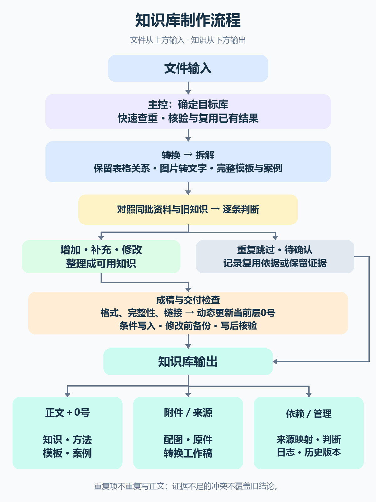

# 使用说明

## 这两个Skill做什么

knowledge-orchestrator是统一入口：确定目标库、查重、判断增加/补充/修改、检查0号和交付。knowledge-processor负责文件转换、知识拆解和整理写作。辅助脚本处理目录准备、指纹、缓存检查、条件提交和格式预检，不替代知识理解或OCR。

## 安装

解压后把两个Skill文件夹并列放入目标Agent支持的技能目录，按宿主规则启用。不要把整个交付包作为单个Skill安装。各Agent的加载机制以实际宿主为准；本包不保证所有Agent已经实测。脚本需要Python 3；OCR、图片理解及完整Markdown渲染能力由宿主提供，本包不捆绑模型。

## 首次建立知识库

可对Agent说：“用knowledge-orchestrator整理这些资料，先问我知识库放在哪个盘或文件夹。”未确定位置时先弹窗或对话询问，确定后再创建。选择父目录时在下面创建“知识汇总”；直接指定库目录则复用它，不再套一层，不固定盘符。

```text
知识汇总/
  00_先看这里.md
  正文/
    00_先看这里.md
    主题目录/
      00_先看这里.md
      01_知识文件.md
  附件/
    00_先看这里.md
  来源/
    00_先看这里.md
  依赖/
    00_先看这里.md
  管理/
    00_先看这里.md
```

缺少结构就创建，已有就直接填充。正文通常是正文/主题两层，不在主题内再建五类公共目录。完整既有内容按用户要求整体归档，不擅自改内部。

## 日常使用

|我要做什么|可以这样说|
|---|---|
|新增资料|把这批文件整理进已有库〈实际路径〉，先比较重复，再增加、补充或修改。|
|只看差异|只检查与旧库的差异，交判断和建议，先不发布正文。|
|判断后入库|继续上次已核验的提取和判断结果入库，不重新从原件加工。|
|小修|只修〈指定文件/位置〉的格式或内容，并检查受影响入口和链接。|
|断点继续|核验已有产物，只继续失败、缺失或失效的阶段。|

## 加工与交付要求

1. 文字型图片转为可搜索、可复制正文；构图、走位等示意图保留并解释，原图可保留核对。
2. 保留完整方法、模板、案例和条件，不把知识正文写成来源摘要。出处与处理记录放依赖/管理。
3. 表格须实际成表，长提示词独立分块，工具和备注与提示词分开；交付前检查结构及重要内容覆盖。
4. 0号随内容增加或位置变化维护，保留清晰的用途、任务导航、顺序、注意和配套入口。正文0号只介绍当前层，进入下一层再查其0号；其他目录按用途组织。
5. 复用完整有效阶段结果，规则/工具配置/输入变化或之前未完成时重新核验。批量提交不等于全库原子事务，失败后按记录恢复，不能盲目重跑。

## 哪些目录可以清理

详见[可清理目录说明](03_可清理目录说明.md)。转换稿、已结束任务的报告/计划、历史版本和日志可以按需要清理，但会分别影响复用、追溯、回退和恢复。原件副本需先确认外部原件可用及引用不受影响。保留正文正在引用的附件与来源映射、各层0号，以及未结束任务的恢复记录。

本包仅提供清理说明，没有清理现有知识库，也没有内置自动清理动作。

## 处理流程


