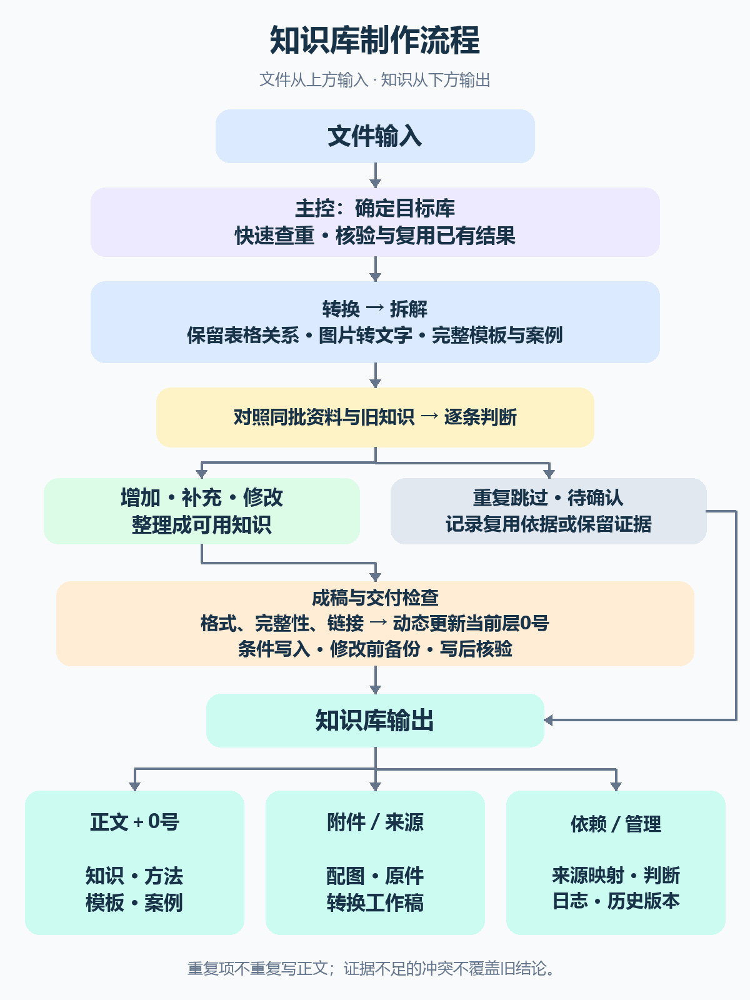

# 知识库双Skill｜通用交付版

An agent-skill package for building and maintaining an Obsidian-style file-based knowledge base: import → refine → precheck → verify → publish → query → incremental update → recover.

- **knowledge-orchestrator** —— 主控：确定目标库、查重、判断增加 / 补充 / 修改、检查 0 号入口与交付
- **knowledge-processor** —— 处理：文件转 Markdown、知识拆解、整理与成品交付

适用宿主：任何支持 SKILL.md 目录式技能的 Agent。脚本需 Python 3；OCR 与图片理解由宿主提供，本包不捆绑模型。

---

## 一、使用说明

### 这两个Skill做什么

knowledge-orchestrator是统一入口：确定目标库、查重、判断增加/补充/修改、检查0号和交付。knowledge-processor负责文件转换、知识拆解和整理写作。辅助脚本处理目录准备、指纹、缓存检查、条件提交和格式预检，不替代知识理解或OCR。

### 安装

解压后把两个Skill文件夹并列放入目标Agent支持的技能目录，按宿主规则启用。不要把整个交付包作为单个Skill安装。各Agent的加载机制以实际宿主为准；本包不保证所有Agent已经实测。脚本需要Python 3；OCR、图片理解及完整Markdown渲染能力由宿主提供，本包不捆绑模型。

### 首次建立知识库

可对Agent说：“用knowledge-orchestrator整理这些资料，先问我知识库放在哪个盘或文件夹。”未确定位置时先弹窗或对话询问，确定后再创建。选择父目录时在下面创建“知识汇总”；直接指定库目录则复用它，不再套一层，不固定盘符。

```text
知识汇总/
  00_先看这里.md
  正文/
    00_先看这里.md
    主题目录/
      00_先看这里.md
      01_知识文件.md
  附件/
    00_先看这里.md
  来源/
    00_先看这里.md
  依赖/
    00_先看这里.md
  管理/
    00_先看这里.md
```

缺少结构就创建，已有就直接填充。正文通常是正文/主题两层，不在主题内再建五类公共目录。完整既有内容按用户要求整体归档，不擅自改内部。

### 日常使用

|我要做什么|可以这样说|
|---|---|
|新增资料|把这批文件整理进已有库〈实际路径〉，先比较重复，再增加、补充或修改。|
|只看差异|只检查与旧库的差异，交判断和建议，先不发布正文。|
|判断后入库|继续上次已核验的提取和判断结果入库，不重新从原件加工。|
|小修|只修〈指定文件/位置〉的格式或内容，并检查受影响入口和链接。|
|断点继续|核验已有产物，只继续失败、缺失或失效的阶段。|

### 加工与交付要求

1. 文字型图片转为可搜索、可复制正文；构图、走位等示意图保留并解释，原图可保留核对。
2. 保留完整方法、模板、案例和条件，不把知识正文写成来源摘要。出处与处理记录放依赖/管理。
3. 表格须实际成表，长提示词独立分块，工具和备注与提示词分开；交付前检查结构及重要内容覆盖。
4. 0号随内容增加或位置变化维护，保留清晰的用途、任务导航、顺序、注意和配套入口。正文0号只介绍当前层，进入下一层再查其0号；其他目录按用途组织。
5. 复用完整有效阶段结果，规则/工具配置/输入变化或之前未完成时重新核验。批量提交不等于全库原子事务，失败后按记录恢复，不能盲目重跑。

### 哪些目录可以清理

详见[可清理目录说明](03_可清理目录说明.md)。转换稿、已结束任务的报告/计划、历史版本和日志可以按需要清理，但会分别影响复用、追溯、回退和恢复。原件副本需先确认外部原件可用及引用不受影响。保留正文正在引用的附件与来源映射、各层0号，以及未结束任务的恢复记录。

本包仅提供清理说明，没有清理现有知识库，也没有内置自动清理动作。

### 处理流程



---

## 二、可清理目录说明

以下路径都相对于实际知识库根目录，不固定盘符。清理的是选定内容，目录本身及各目录的0号建议保留。按已结束批次清理，优先于整目录清空。

|内容|相对文件夹|清理条件与影响|
|---|---|---|
|转换工作稿|来源/转换稿/|原件可再读取、正文已核验；删除后重做可能需要重新转换或OCR。|
|判断与检查报告|管理/测试报告/|所属任务已结束，重要结论已落实或另有保留；删除后失去详细判断依据。|
|提交计划与阶段状态|管理/更新计划/|对应任务已结束且产物核验通过、不再需要恢复；删除可能失去阶段复用信息或重复提交凭据。|
|历史版本与快照|管理/历史版本/|当前结果已确认，不再需要回退；删除后无法从这些快照恢复。|
|历史日志|管理/日志/|接受失去历史处理事实与部分查重/恢复依据后再清理；不得在写入进程运行时删日志或锁文件。|
|库内原件副本|来源/原件/|先确认外部原件及版本仍可用，并检查依赖引用；不能只因同名就认为有备份。|

### 应保留的内容

- 正文与各层0号。
- 正文引用的附件：配图、动作图、结构图、原图核对链接所用文件。无引用不等于无用途，删除前确认。
- 依赖中的来源映射与必要说明。其指向原件或工作稿时，清理前修正失效定位。
- 未完成、部分失败、冲突任务的计划、状态和恢复快照；任务状态不明时先核实。

### 推荐顺序

先确认任务结束及正文可用 → 检查依赖和资源引用 → 先清转换稿及过期报告 → 再选择是否清理历史版本、计划与日志 → 最后考虑原件副本。

需要保留重复检测能力时，可保留精简来源指纹和已处理产物对应关系；它们不能代替原件或自动证明资料已完整提取。日志/提交状态丢失后，不要直接重放旧提交计划覆盖现有文件，先重新比较。

这些是可清理位置说明，不是删除指令，也不表示清理后不会影响功能。

---

## 三、更新日志

本日志记录本测试包已完成的变更。以下为2026-11-17同日迭代，按先后列出；不代表已在所有Agent验证。

### 初始双Skill版本

- 拆为knowledge-orchestrator主控和knowledge-processor处理器，支持后续登记扩展能力。
- 将资料处理分为转换、拆解、重复与旧知识判断、整理交付；按阶段读取规则。
- 判断支持增加、补充原文、补充成篇、修改、重复跳过、仅更新依赖和待确认。
- 来源与处理说明从知识正文分离，保留完整提示词、案例、字段和适用条件。

### 目录与自动准备

- 加入layout辅助命令，缺失目录与入口自动创建，已有内容不覆盖。
- 采用附件、管理、来源、依赖、正文及根0号结构；附件按来源归组。
- 日志、状态、历史版本归管理，每批依赖说明单独保存为Markdown。
- 增加旧日志检测，避免忽略历史另开事件流。

### 完整内容归档与总根目录修正

- 完整内容文件夹可只改外层名称并整体归入正文，内部文件、目录、资源及原0号保持不变。
- 明确五类公共目录只属于总库根目录；正文主题不再重复建立一套知识库结构。
- 明确首次未选位置时先弹窗或对话询问盘符/文件夹，不固定F盘，不擅自使用当前工作目录。
- 确定实际根路径后记住并复用，后续只填充内容、补齐缺项及更新相关导航。
- 保留用户已有.obsidian配置与canvas，不自动修改。

### 跨Agent测试包文档补齐

- 合并打包两个并列Skill，顶层增加测试说明、使用说明和本更新日志。
- 使用说明包含安装、首次选址、目录结构、日常指令和建议测试项目。

### 验证范围

- 两个Skill均通过格式校验；此前辅助脚本10项检查与目录行为5项检查通过。
- 压缩包完整性及必需文件检查通过。
- 未在其他Agent实际完成安装或端到端测试，兼容性由本轮外部测试确认。


### 2026-11-17：图片文字交付修正

- 主控新增图片知识完整性验收：文字型图卡必须转成可搜索、可复制正文，不能仅嵌图交付。
- 处理器新增图片文字提取与图文交付规则，转换、拆解、整理阶段均链接该规则。
- 按文字型、示意型、图文混合和装饰类分别处理；保留原图，重要文字与表格完整提取。
- 核对图号、跨页编号、子项数、漏行、OCR错字、单位与参考标签；未读清的重要部分标部分完成。
- 文字参与语义查重，图片hash不代表知识层重复；原图存在不代表提取完成。
- 本轮正文修正覆盖118条指令、16组共53条子提示词、41项案例及两份图解速查；这是本次验证样本，不写成Skill的固定条目数。


### 2026-11-17：Markdown结构修复与验收

- 修复05八状态表缺失分隔行导致不渲染的问题。
- 修复06十类模板直接粘贴纯文本的问题：十个标题及十个完整代码块，恢复断裂P##标签。
- 两个Skill增加Markdown结构验收，处理器转换与交付规则要求恢复表格、标题、列表和模板边界。
- 本轮用Markdown解析器检查7列表、8条数据、10个完整模板块及内容保留；不把hash/链接校验当格式验证。


### 2026-11-17：动态分层0号入口

- 根与五类公共目录均有0号，正文主题保留各自入口。
- 正文0号严格只索引当前层，不展开更深文件；其他目录按用途组织。
- 增加、补充、纠错、迁移和更名后检查并维护受影响0号，纳入交付与日志。
- layout补齐五类目录0号；保留现有入口，Agent负责实际索引内容维护。


### 2026-11-17：恢复0号任务入口排版

- 恢复用途、任务导航、使用顺序、注意事项与配套导航的清晰分节。
- 保留动态维护和正文分层边界；任务导航改为具体使用需求，不把文件名当用途重复展示。
- 明确后续更新应沿用用户认可的入口格式，不退化为目录清单。


### 2026-11-17：执行效率优化

- 增加小修、候选入库、增量与批量任务分流，复用本会话规则和已核验阶段结果。
- 新增knowledge_batch.py：缓存有效性检查、批量条件提交、仅备份修改文件、重复提交复用、冲突拒绝及失败记录。
- 公共脚本不提供语义判重、OCR或自动恢复；图文完整性、0号和格式标准不降低。
- 阶段计时按真实执行记录，不承诺未经同批实测的加速比例。
- 新工具10项临时库测试通过，覆盖创建/修改/备份/复用、版本冲突、缓存失效、路径越界和保护范围。


### 2026-11-17：表格型提示词结构修正

- 修复12号8个案例的标题/复制块/工具与备注关联，原提示词逐块一致。
- 转换阶段要求保留表格行列字段，不直接粘贴扁平纯文本。
- 新增markdown_preflight.py，检查表格分隔行、围栏与预期数量，提示裸字段/工具孤行。
- 小修后轻量扫描同生成路径稿件；预检不替代渲染和语义审校。
- 6项格式回归检查通过，并扫描本主题全部15份Markdown。


### 2026-11-17：通用交付副本

- 从原跨Agent测试包复制生成，保留两个Skill与脚本内容不变。
- 移除顶层测试说明，加入使用入口并重新整理使用说明。
- 增加可清理目录、条件和影响说明，不执行任何知识库清理。
- 加入3:4竖版PNG流程图。原测试压缩包保留。

---

## 包结构与安装

```text
知识库双Skill_通用交付版/
  00_先看这里.md
  01_使用说明.md
  02_更新日志.md
  03_可清理目录说明.md
  04_知识库处理流程图.png
  knowledge-orchestrator/
    SKILL.md  agents/openai.yaml  references/*.md  scripts/*.py
  knowledge-processor/
    SKILL.md  agents/openai.yaml  references/*.md  scripts/*.py
```

把 `knowledge-orchestrator/` 与 `knowledge-processor/` 两个文件夹**并列**放入宿主 Agent 的技能目录，按宿主规则启用。不要把整个交付包当作单个 Skill 安装。
